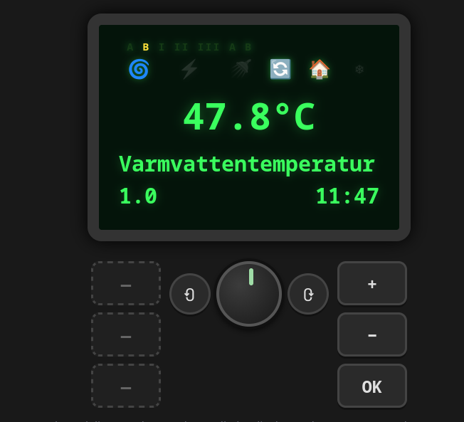

# Nibemote — Nibe VVM300/F2025 display replacement (ESPHome)

A Waveshare ESP32-S3-Relay-1CH replaces the VVM300's display card (bus address
`0x00F9`) on the pump's internal RS485 bus — 19200 baud, Nibe 9-bit legacy
framing. The VVM300 keeps serving its display rows; the ESP
publishes them to Home Assistant using esphome's builtin interface and a
built-in web page, and sends button and knob input back as display key events.
A sniffer build (listens only, never transmits) is included for wire debugging.

The exchange engine is split by timing: byte capture, the poll/grant/close
mechanics and timed emission run on the interrupt side (UART ISR plus a 125 µs
timer), so replies leave inside the master's window; frame parsing, checksums,
command meaning and policy run in the task, where they are plain C++ and testable.
The previous attempt (../nibemote) did byte capture from the main loop and bus
chaos ensued; this design is the fix.

Validated live against a VVM300 + F2025: rows, menu navigation, knob (heating
curve), clock answer, F2025 telemetry sensors.



## Quick start

```bash
make env                                              # one-time: .venv from uv.lock
cp configs/secrets.yaml.example configs/secrets.yaml  # wifi credentials
make gate                                             # validate + compile + IRAM audit + tests + sim

make flash-emulator                                  # production image (OTA)
make flash-sniffer                                    # passive listener (OTA)
```

First-ever flash is over USB-C (see docs/bring-up.md); `DEVICE=` overrides
the OTA address. Adoption into the Esphome controller required for Home Assistant.

## Layout

| path | contents |
|---|---|
| `components/rs485_bus/` | generic ISR RS485 transport, 9-bit line format |
| `components/nibe/` | Nibe bus engine, display emulator, ESPHome entities |
| `configs/nibemote.yaml` | display emulator |
| `configs/nibemote-sniffer.yaml` | passive sniffer |
| `configs/nibemote-host.yaml` + `sim/vvm300_sim.py` | host build + simulated VVM300 for tests |
| `docs/` | protocol, command map, architecture, bring-up |

## Web page

The emulator serves the virtual display on `display_web_port` (8080 in
`configs/nibemote.yaml`): `/` is the page, `/j` the JSON state it polls. Actions are
`GET /?k=<action>`: `plus`, `minus`, `enter`, `kl`/`kr` (one knob detent), and
`frame`/`raw` for arbitrary frames:

```bash
# frame without checksum: cmd, sender hi/lo, len, data — the device appends XOR-8
curl 'http://<device>:8080/?k=frame&hex=7200F9020511'   # register 0x11 read
# the same frame sent verbatim, checksum included (for checksum experiments)
curl 'http://<device>:8080/?k=raw&hex=7200F90205119D'
```

`frame` is the normal path; `raw` adds nothing and is there when the checksum is
the thing you're testing. Both refuse unless the emulator is armed, and both send
what you give them — including register writes (`76 ...`) — so treat them as a
shell on the heating bus.

## Logs

`log_level: 1` (default) prints one line per transfer window, in wire order:

```
[I][nibe]: ex 41C9 @16164027 | rx 06 ACK | rx 000A 71[00] | rx 05 ENQ | rx 06 ACK | rx 41C9 71[02 00 00 DA 9D ...] | rx 06 ACK | rx 03 ETX
[I][nibe]: ex 00F9 @260521911 | tx 05 ENQ | rx 06 ACK | tx 40[40 88 00 00] | rx 06 ACK | tx 03 ETX
```

`tx` is us, `rx` is the master or another node (frames show their sender); rows 2–4
render as text, other frames as hex. `*` after a control byte means its ninth bit read
1: `rx 03 ETX*` is the master closing its push, plain `ETX` is a node closing its own
frame (and `tx 05 ENQ*` is our marked ENQ). The exchange line appears when the next poll
opens the next window, or after a second of silence. Poll-only windows (an unarmed
panel's silent slot) are not printed. `log_level: 2` adds the per-frame/ctrl/gap
detail and the tx pacing; `0` keeps only the 10 s summary and the health line.

## Wiring

RS485 A/B/GND from the display port's RJ45 to the screw terminal
(TX GPIO17, RX GPIO18, EN GPIO21). Power the board from USB or its own 5 V supply —
never load the RJ45 rails. The panel is hot-swappable: boot the ESP unarmed, put it
on the bus, then flip the arm switch; the emulator announces to the master. The
legacy panel can be reinstalled at any time.

## Safety posture

- Sniffer build cannot transmit (EN pinned low, `send_burst()` refuses).
- The emulator boots silent and acts only when the arm switch is on;
  flipping it off is instant silence and the master falls back to its
  absent-node backoff.
- No parameter writes, no polling of other nodes. Reinstalling the physical
  display restores the stock system at any time.

Heating is safety-critical: read `docs/bring-up.md` before connecting
anything, and `docs/protocol.md` for the wire protocol.
